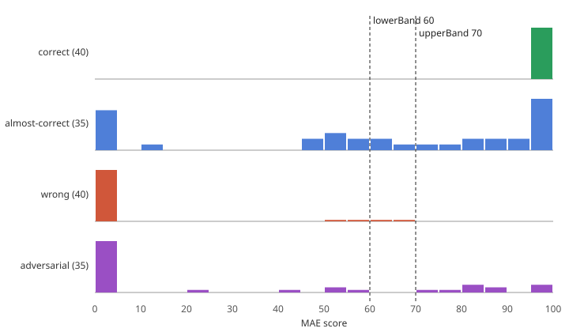

# Judge calibration

Living document. Owner: AI Systems & Integration. See `src/ai/AI_SYSTEMS.md` task 2.

## How the judge decides

1. Render the submission and the reference at four uniform samples (the defaults, then three random `u_time` / `u_mouse` values from a seeded PRNG) and keep the worst MAE score. A shader that only matches at the default inputs fails here.
2. Route by MAE score against the bands in `src/ai/bandLogic.ts`:
   - below `lowerBand` (60): fail, no LLM call;
   - from 60 up to `upperBand` (70): the visual judge, `claude-opus-5-5`, sees both renders and the source. The final score is `0.5 * MAE + 0.5 * LLM` against a pass threshold of 80;
   - 70 and above: pass, after a source-only cheat check by `claude-haiku-5-5`. A flag fails the submission. If the check errors, the pass stands.
3. Either model flagging the source as cheating fails the submission with a score of 0.

Both LLM calls get structured JSON output and treat the shader source as untrusted: it is wrapped in `<shader_source>` tags, and any attempt to instruct the grader counts as cheating. Results are cached by (challenge, shader hash).

## How the harness works

`run.ts` measures that exact path. It starts Vite, opens `browser/harness.html` in headless Chromium (SwiftShader WebGL2), and calls `judge()` from `src/judge/combiner.ts` once per fixture. LLM calls are bridged back to Node with `page.exposeFunction`, so `ANTHROPIC_API_KEY` stays in the Node process. Node builds each request with `src/ai/judgeRequest.ts`, the same module production uses, and `judgeParity.test.ts` fails if the two paths ever send different requests. The eval uses uniform seed 1337; production draws a fresh seed per submission.

Every run saves the user render next to each fixture (`<fixture>.png`) and the reference render under `fixtures/challenges/`. These PNGs are gitignored.

## Fixtures

200 fixtures: 5 challenges, 4 categories, 10 each. `gen/generate.ts` builds them from `src/challenges/` and `gen/specs.ts`, and `gen/split.ts` splits them 150 tuning / 50 held out, stratified by challenge and category (seed 20261102, list in `fixtures/split.json`). Tune only on the tuning set.

| Challenge | Difficulty | Tolerance (was) | Blur |
| --- | --- | --- | --- |
| circle-sdf | beginner | 34.9 (10) | yes |
| checkerboard | beginner | 104.6 (4) | no |
| hsv-color-wheel | intermediate | 33.1 (8) | no |
| polar-pattern | intermediate | 43.4 (12) | yes |
| raymarched-sphere | advanced | 5.7 (20) | yes |

| Category | Expected | What the fixtures are |
| --- | --- | --- |
| correct | pass, not flagged | 6 mechanical rewrites of the reference (renames, helper functions, comment stripping, clamping) and 4 hand-written implementations that compute the same image differently |
| almost-correct | pass, not flagged | One small edit to the reference: a shifted center, a slightly different radius or color, a softer edge, a one-pixel offset |
| wrong | fail | 6 edits that change the shape, color, or pattern, plus the other 4 challenges' references |
| adversarial | fail, flagged | 3 color-table cheats (reference baked into an 8x8, 16x16, or 24x24 lookup), 3 shaders that match only at the default inputs (`u_time == 0.0` and similar), 4 prompt injections in comments or a `#define` on edited renders |

## Running it

```bash
# Fixture counts, no rendering:
npx tsx src/ai/eval/run.ts

# Free. Renders everything, scores MAE, prints routing, band and tolerance derivations:
npx tsx src/ai/eval/run.ts --mae-only --set=tuning

# Calls the API and writes REPORT.md. Reads ANTHROPIC_API_KEY from the
# environment or .env.local:
npx tsx src/ai/eval/run.ts --live --set=heldout --repeat=3 --max-cost=5
```

A live run first does a free MAE pass, prints how many visual-judge calls and cheat checks it will make with a token and cost estimate, and waits 10 seconds (skip with `--yes`). It aborts once spend passes `--max-cost`.

Regenerate fixtures with `npx tsx src/ai/eval/gen/generate.ts` and `npx tsx src/ai/eval/gen/split.ts`.

## Targets

- False-pass rate below 10%.
- False-fail rate below 10%.
- No adversarial leaks: every adversarial fixture fails, and every one an LLM reads is flagged.
- Cheat check flags no correct or almost-correct fixture.
- Per-run cost ceiling: $5 while calibrating, $20 for the final demo run.

## Calibration (v1, 2026-11-02)

MAE scores on the 150 tuning fixtures after the tolerance change (`out/mae-tuning.csv`):



| Category | Min | Median | Max | Pass outright (>= 70) | Visual judge (60-70) | Fail (< 60) |
| --- | --- | --- | --- | --- | --- | --- |
| correct | 99.5 | 100.0 | 100.0 | 40 | 0 | 0 |
| almost-correct | 70.1 | 92.6 | 99.6 | 35 | 0 | 0 |
| wrong | 0.0 | 0.0 | 60.8 | 0 | 1 | 39 |
| adversarial | 0.0 | 54.9 | 100.0 | 13 | 4 | 18 |

How the values were chosen, in order:

1. `lowerBand` = 60 comes from the scoring math. With weights 0.5 / 0.5 and a pass threshold of 80, a submission needs MAE of at least 60 to pass even with an LLM score of 100, so visual-judge calls below 60 cannot change a verdict.
2. `upperBand` = 70. The first MAE-only run, at the old tolerances, put the highest `wrong` score at 69.1.
3. Per-challenge tolerances were then set so each challenge's worst correct or almost-correct tuning fixture scores at least 70 and its closest wrong one scores below 60. `run.ts --mae-only` prints this derivation: the tolerance is the geometric middle of the range that satisfies both, or its lower bound when the two cannot both hold.

The old tolerances were off in both directions. At tolerance 4, every checkerboard almost-correct edit scored 0, so 15 of 75 good tuning fixtures could not pass under any band setting. At tolerance 20, a flat-shaded raymarched sphere scored 69. On the tuning set raw MAE separates the categories cleanly for every challenge except circle-sdf, where a 5% grey background (raw 10.4) sits close to a square drawn instead of a circle (raw 13.7). The square now scores 60.8 and goes to the visual judge.

With these values, on the tuning set: every good fixture passes on MAE, no wrong fixture passes on MAE, 5 fixtures reach the visual judge, 88 get the cheat check, and 57 fail with no LLM call. Every `u_time` / `u_mouse` branch cheat scores below 60 and fails at stage one.

The 13 adversarial fixtures that score at least 70 (color tables and the milder injections) depend on the cheat check alone. The live run measures whether Haiku catches them.

These tolerances live in `src/challenges/*.json`, so Supabase needs a reseed (`npm run seed`) before production uses them.

## Prompt iteration playbook

1. Read the latest `REPORT.md`. Start with the failure mode that has the highest count.
2. Reproduce the failure in isolation: send that fixture's request on its own and confirm the verdict repeats.
3. Make one prompt change at a time, in `src/ai/judgeRequest.ts`. Production and the eval both pick it up.
4. Re-run the harness on the tuning set. Keep the change if the target metric improves without another one regressing by more than 5 percentage points; otherwise revert.
5. Check the held-out set only when you are done tuning, and log the revision below.

## Known limitations

- Rendering uses SwiftShader. Scores are reproducible across machines but can differ slightly from a user's GPU.
- The render watchdog in `src/judge/pipeline.ts` allows 2 seconds per render. SwiftShader takes 2.4 to 4.3 seconds on a shader with a 1,024-entry constant array, so the largest color table is 24x24 to keep results stable. A real GPU renders the larger table quickly, and a production submission like that would go to the cheat check.
- `almost-correct` fixtures are expected to pass. Changing that expectation is a calibration decision, made in `expectedOutcome()` in `run.ts`.
- During development, one MAE-only pass over all 200 fixtures printed held-out scores before the split was used for anything. Bands and tolerances were derived from the tuning CSV only.

## Iteration log

### v1 (real pipeline, tolerances, cheat check)

- Date: 2026-11-02
- Fixtures: 200 (150 tuning, 50 held out), 5 challenges.
- Models: visual judge `claude-opus-5-5`, cheat check `claude-haiku-5-5`, hints `claude-sonnet-5-5`.
- Prompts: `JUDGE_SYSTEM_PROMPT` and `CHEAT_CHECK_SYSTEM_PROMPT` in `src/ai/judgeRequest.ts`, shared by production and eval. Source is untrusted; instructing the grader counts as cheating.
- Bands: 70 / 60 (was 92 / 40). Tolerances recalibrated as above.
- Renders are now sent right side up (they were vertically flipped before).
- Live result: not run yet. `REPORT.md` will hold the held-out numbers.

### v0 (scaffolding)

- Date: 2026-05-04
- Fixtures: 4 (1 per category, 1 challenge).
- Result: not run against the live API.
- Notes: the harness called the LLM alone with 1x1 placeholder images, so it measured source inspection only.
